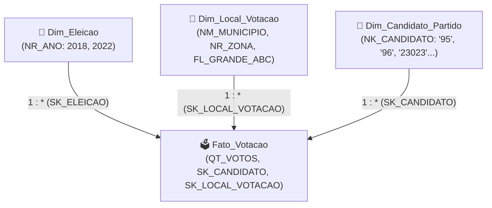
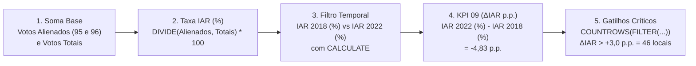

# Curso Prático & Apostila Passo a Passo: Dominando o Power BI com o KPI 09 (Do Zero ao Tier-Elite)

Bem-vindo à sua aula prática de **Business Intelligence e Engenharia Analítica no Power BI Desktop**!

A sua aba oficial (**`KPI 09 — Panorama Eleitoral SP`**) já está **100% pronta, validada e salva** no arquivo [Power b.i com banco de dados.pbix](file:///c:/Innovation-Lab---Applied-BI/Arquivos%20do%20projeto/Atividades/Power%20b.i%20com%20banco%20de%20dados.pbix). O objetivo deste guia é funcionar como um **professor particular ao seu lado**: você vai abrir uma **aba nova em branco (`+`)** dentro do mesmo arquivo — sem correr nenhum risco de estragar a aba pronta — e aprender exatamente **onde clicar, o que arrastar e o porquê de cada decisão técnica**.

````carousel

<!-- slide -->

````

---

## Módulo 1: Anatomia do Power BI Desktop (Entendendo a Tela em 5 Minutos)

Quando você olha para o Power BI Desktop aberto na sua tela, você precisa conhecer apenas **3 regiões principais**:

### 1.1. Barra Lateral Esquerda (Os 4 Modos de Visão)
Olhe para a coluna bem fininha no canto esquerdo da janela do Power BI. Há 4 ícones empilhados:
1. 📊 **Exibição de Relatório (1º ícone):** É a tela onde você desenha os gráficos (o *Canvas*). É onde você passará 80% do tempo.
2. 📋 **Exibição de Tabela / Dados (2º ícone):** Parece uma planilha de Excel. Se você clicar nele e depois clicar em `Dim_Local_Votacao` na direita, verá todas as linhas e colunas reais da tabela (municípios, zonas, colégios).
3. 🕸️ **Exibição de Modelo (3º ícone):** Mostra o diagrama de blocos e linhas conectando as tabelas. É aqui que mora o famoso **Star Schema** (Esquema em Estrela).
4. 💻 **Exibição de Consulta DAX (4º ícone):** Um console avançado para testar consultas DAX em texto.

### 1.2. Painéis da Direita (O Motor de Construção)
No canto direito da tela ficam 2 painéis essenciais (se estiverem recolhidos, basta clicar na setinha `<<` ao lado do nome deles para abrir):
- **Painel `Dados`:** Lista as **7 tabelas oficiais** do projeto. Quando você clica na setinha `>` ao lado de `Fato_Votacao`, você vê uma pastinha chamada **`KPI 09 - Alienacao Eleitoral`** com ícones de **calculadora** (🖩). No Power BI, todo ícone de calculadora é uma **Medida DAX**!
- **Painel `Visualizações`:** É onde você escolhe o tipo de gráfico (Cartão, Rosca, Colunas, Tabela) e formata as cores. Ele tem **duas abas no topo**:
  - **Ícone de Gráfico com Barras (`Construir um visual`):** Onde você arrasta as colunas e medidas (*Eixo X*, *Eixo Y*, *Legenda*, *Valores*).
  - **Ícone de Pincel 🖌️ (`Formatar seu visual`):** Onde você muda cores, tamanho de fonte, ativa rótulos de dados e deixa o fundo transparente.

### 1.3. Rodapé (As Abas de Página)
Lá embaixo, igual ao Excel, está escrito **`KPI 09 — Panorama Eleitoral SP`** e ao lado há um botão verde **`+`**.

> [!TIP]
> **Regra de Ouro para Aprender sem Medo:**
> Nunca edite a aba `KPI 09 — Panorama Eleitoral SP` diretamente enquanto estiver treinando. Clique no botão **`+`** no rodapé para criar a **`Página 2`** (você pode clicar duas vezes no nome dela e chamar de `Treino KPI 09`). Quando terminar de estudar, basta clicar com o botão direito na aba `Treino KPI 09` e escolher **Excluir página** antes de entregar o trabalho!

---

## Módulo 2: Por que usamos o Star Schema? (A Regra do Henrique Castilho)

Na mensagem que o Henrique Castilho te mandou, ele pediu: *"Quando comecei a fazer o Power BI não tinha essas tabelas que começam com VW_KPI e nem esse (REVISAR)... não usa elas, porque senão vai ficar diferente dos KPIs que já estão prontos."*

### O que isso significa na prática e na teoria acadêmica?
Em Engenharia de Dados (metodologia de *Ralph Kimball*), nunca jogamos uma tabela gigante pré-pronta para cada gráfico (`VW_KPI_*`), porque isso duplica dados na memória RAM e impede que um filtro de **Município** filtre todos os KPIs da equipe ao mesmo tempo.

Em vez disso, usamos o **Star Schema (Esquema em Estrela)**:



- **Tabelas Dimensão (`Dim_*` — As pontas da estrela):** Respondem **"QUEM, ONDE e QUANDO?"** (`Dim_Eleicao` tem o Ano; `Dim_Local_Votacao` tem o Município, Zona e Colégio; `Dim_Candidato_Partido` tem o código natural `NK_CANDIDATO`, incluindo `"95"` para Voto em Branco e `"96"` para Voto Nulo). Você usa colunas das tabelas `Dim_*` nos **Filtros (Slicers)**, nos **Eixos dos Gráficos** e nas **Fatias das Roscas**.
- **Tabela Fato (`Fato_Votacao` — O centro da estrela):** Responde **"QUANTO?"** (guarda apenas as chaves substitutas `SK_*` e a quantidade de votos `QT_VOTOS`). Você usa a `Fato_Votacao` para criar as **Medidas DAX (Calculadoras 🖩)** que somam e calculam porcentagens.

> [!NOTE]
> **Exercício Rápido de 30 segundos:**
> Clique no **3º ícone da barra esquerda (Exibição de Modelo)**. Você verá exatamente esse desenho em estrela! Repare nas linhas que ligam `Dim_Eleicao` e `Dim_Local_Votacao` até `Fato_Votacao` com `1` de um lado e `*` (muitos) do outro. Depois volte para o **1º ícone (Exibição de Relatório)**.

---

## Módulo 3: Preparando sua Tela "Nova" com o Design do Figma (`1920x1080`)

Você reparou como o nosso dashboard parece um sistema futurista e não um relatório branco comum do Power BI?
O segredo que as grandes consultorias usam é separar a **Moldura Visual (Background em PNG feito no Figma/Python)** dos **Gráficos Interativos (Visuais Transparentes do Power BI)**.

Vamos fazer isso juntos na sua aba nova!

### Passo 3.1: Criar a Aba de Treino e Configurar para Full HD (`1920x1080`)
1. Clique no botão **`+`** no rodapé inferior do Power BI Desktop para criar uma página nova em branco.
2. Clique uma vez no fundo branco vazio da página (para garantir que nenhum gráfico esteja selecionado).
3. No painel **`Visualizações`** (à direita), clique no ícone do **Pincel 🖌️ (`Formatar sua página do relatório`)**.
4. Clique em **`Configurações da tela`**:
   - Em **Tipo**, mude de *16:9* para **`Personalizar`**.
   - Em **Altura**, digite **`1080`** px.
   - Em **Largura**, digite **`1920`** px.

### Passo 3.2: Colocar a Moldura Cyber-Neon do Figma no Fundo
Ainda no painel do **Pincel 🖌️ (`Formatar sua página do relatório`)** com a tela vazia selecionada:
1. Clique na seção **`Tela de fundo`**.
2. Em **Imagem**, clique no botão **`Procurar`** (ícone de pasta).
3. Navegue até a pasta `C:\Innovation-Lab---Applied-BI\Assets\Protótipos\` e selecione o arquivo:
   [figma_bg_1920x1080.png](file:///c:/Innovation-Lab---Applied-BI/Assets/Prot%C3%B3tipos/figma_bg_1920x1080.png)
4. **O Pulo do Gato:** Por padrão, o Power BI coloca a imagem com `100%` de transparência (invisível!). Mude o controle deslizante de **Transparência** de `100%` para **`0%`**.
5. Em **Ajuste da imagem**, mude de *Normal* para **`Ajustar` (*Fit*)**.

Pronto! Instantaneamente a sua página de treino ganhará todas as caixas neon, títulos, ícones circulares e o card dourado de Santo André! Agora só precisamos colocar os números e gráficos vivos dentro das caixas.

---

## Módulo 4: Entendendo e Criando as Medidas DAX do KPI 09

Antes de arrastar os gráficos, todo analista de BI precisa entender **como o cálculo do KPI 09 funciona no DAX**.

### O que é DAX e como ver as fórmulas que já estão prontas?
No painel **`Dados`** (à direita), expanda a tabela **`Fato_Votacao`** e depois expanda a pasta **`KPI 09 - Alienacao Eleitoral`**.
Se você clicar **uma vez com o botão esquerdo** sobre qualquer medida (ex.: `KPI 09 - Delta IAR (p.p.)`), aparecerá uma **Barra de Fórmulas** no topo da tela (igual ao Excel) mostrando o código DAX daquela medida!

Se você quiser **criar uma medida nova para treinar**:
1. Clique com o **botão direito** em cima do nome da tabela **`Fato_Votacao`**.
2. Clique em **`Nova medida`**.
3. Digite a fórmula na barra superior e aperte **Enter**.

Vamos dissecar as **5 fórmulas pilares do KPI 09** como em uma aula de faculdade:



### Fórmula 1: Somar apenas Votos Brancos (`"95"`) e Nulos (`"96"`) no Star Schema com `CALCULATE`
Na urna eletrônica do TSE, o voto em Branco recebe o código `"95"` e o voto Nulo recebe o código `"96"`. Na modelagem **Star Schema**, a tabela fato (`Fato_Votacao`) não guarda textos nem códigos naturais: os códigos `"95"` e `"96"` ficam na tabela dimensão **`Dim_Candidato_Partido[NK_CANDIDATO]`**.
Além disso, usamos **`REMOVEFILTERS(Dim_Candidato_Partido)`** antes do filtro para blindar a medida (garantindo que, mesmo se alguém filtrar um candidato ou partido na tela, o cálculo de votos alienados da urna continue exato):

```dax
Votos Alienados (Brancos e Nulos) = 
CALCULATE(
    SUM(Fato_Votacao[QT_VOTOS]),
    REMOVEFILTERS(Dim_Candidato_Partido),
    Dim_Candidato_Partido[NK_CANDIDATO] IN {"95", "96"}
)
```
*(E para `Votos Totais Cargo Urna`, usamos `CALCULATE(SUM(Fato_Votacao[QT_VOTOS]), REMOVEFILTERS(Dim_Candidato_Partido))`!)*

### Fórmula 2: Calcular a Taxa de Alienação ($IAR\text{ \%}$) com `DIVIDE`
Nunca usamos a barra `/` para dividir no Power BI, pois se um colégio eleitoral tiver 0 votos em algum ano, a barra `/` gera erro (`Infinity`/`NaN`). Usamos sempre **`DIVIDE(numerador, denominador, 0)`**:

```dax
IAR Taxa Alienacao (%) = 
DIVIDE(
    [Votos Alienados (Brancos e Nulos)],
    [Votos Totais Cargo Urna],
    0
) * 100
```

### Fórmula 3: Separar 2018 e 2022 usando o Star Schema (`Dim_Eleicao[NR_ANO]`)
Repare como o Star Schema brilha aqui! Para saber o $IAR$ de 2018 e o de 2022, pedimos para a `CALCULATE` reaproveitar a medida `[IAR Taxa Alienacao (%)]` filtrando a tabela dimensão `Dim_Eleicao`:

```dax
IAR 2018 (%) = 
CALCULATE(
    [IAR Taxa Alienacao (%)],
    Dim_Eleicao[NR_ANO] = 2018
)
```
*(E para `IAR 2022 (%)`, basta trocar `2018` por `2022`!)*

### Fórmula 4: O Cálculo Oficial do KPI 09 ($\Delta IAR$ em Pontos Percentuais)
O KPI 09 é a diferença em pontos percentuais entre 2022 e 2018 ($\Delta IAR = IAR_{2022} - IAR_{2018}$), garantindo que o colégio eleitoral existiu nos dois pleitos (`vTot18 > 0 && vTot22 > 0`):

```dax
KPI 09 - Delta IAR (p.p.) = 
VAR vTot18 = CALCULATE([Votos Totais Cargo Urna], Dim_Eleicao[NR_ANO] = 2018)
VAR vTot22 = CALCULATE([Votos Totais Cargo Urna], Dim_Eleicao[NR_ANO] = 2022)
RETURN
IF(
    vTot18 > 0 && vTot22 > 0,
    [IAR 2022 (%)] - [IAR 2018 (%)],
    BLANK()
)
```
- **Para o Reduto de Santo André (`-7,70 p.p.`):** Basta filtrar o município na `Dim_Local_Votacao`:
```dax
KPI 09 - Delta IAR Santo Andre = 
CALCULATE(
    [KPI 09 - Delta IAR (p.p.)],
    CONTAINSSTRING(Dim_Local_Votacao[NM_MUNICIPIO], "SANTO ANDR")
)
```

### Fórmula 5: Contar quantos Colégios dispararam o Gatilho Crítico ($\Delta IAR > +3,00\text{ p.p.}$)
Como saber quantos dos `11.164` colégios eleitorais de SP tiveram alta crítica acima de `+3,00 p.p.`? Usamos `VALUES(Dim_Local_Votacao[SK_LOCAL_VOTACAO])` para listar cada colégio único, `FILTER` para manter só os que têm `[KPI 09 - Delta IAR (p.p.)] > 3`, e `COUNTROWS` para contá-los (resultando em **`46 locais`**):

```dax
KPI 09 - Qtd Locais Gatilho > 3 p.p. = 
COALESCE(
    COUNTROWS(
        FILTER(
            VALUES(Dim_Local_Votacao[SK_LOCAL_VOTACAO]),
            Dim_Local_Votacao[SK_LOCAL_VOTACAO] > 0 && [KPI 09 - Delta IAR (p.p.)] > 3
        )
    ),
    0
)
```

---

## Módulo 5: Mão na Massa — Construindo os 5 Tipos de Gráficos na Sua Aba de Treino

Agora que você já está na sua **aba nova de treino** com o fundo do Figma aplicado, vamos colocar os 5 tipos de visuais dentro das molduras!

> [!IMPORTANT]
> **Dica de Ouro antes de cada novo gráfico:**
> Sempre clique em uma área **vazia** da tela antes de escolher um novo gráfico no painel `Visualizações`. Se você estiver com um gráfico selecionado e clicar em outro ícone no painel `Visualizações`, o Power BI **transforma** o gráfico selecionado em vez de criar um novo!

---

### Prática 1: Criando um Filtro Dropdown (Slicer) no Topo Direito
Vamos colocar o filtro de **Município (SP)** na 2ª caixinha do cabeçalho superior direito:
1. Clique no fundo vazio da página.
2. No painel **`Visualizações`**, clique no ícone **`Segmentação de dados`** (parece um pequeno funil dentro de uma tabela).
3. No painel **`Dados`**, abra a tabela **`Dim_Local_Votacao`** e arraste a coluna **`NM_MUNICIPIO`** para o campo **`Campo`** do visual.
4. Por padrão, ele aparece como uma lista comprida. Para transformá-lo em **Dropdown (Suspenso)**:
   - Clique no ícone do **Pincel 🖌️ (`Formatar seu visual`)**.
   - Abra **`Configurações da segmentação`** $\rightarrow$ **`Opções`** $\rightarrow$ mude **Estilo** de *Lista vertical* para **`Suspenso`**.
   - Desative o **`Cabeçalho da segmentação`** (*Desativado*), pois o nosso fundo do Figma já tem o título `"Município (SP)"` desenhado em ciano!
   - Em **`Valores`**, mude a **Cor da fonte** para branco (`#E8EAF6`) e a **Tela de fundo** para azul-escuro (`#0D1430`).
5. Arraste e redimensione a caixinha para encaixar dentro da moldura `"Município (SP)"` no topo direito.

---

### Prática 2: Criando os Cartões de Destaque (Hero KPI Cards — Fileira 1)
Vamos criar o 1º grande cartão (**`-4,83 p.p.`**) e o 2º (**`-7,70 p.p.`**):
1. Clique no fundo vazio da página.
2. No painel **`Visualizações`**, clique no ícone **`Cartão`** (o ícone clássico que tem o número **`123`**).
3. No painel **`Dados`** (`Fato_Votacao` $\rightarrow$ `KPI 09 - Alienacao Eleitoral`), arraste a medida **`KPI 09 - Delta IAR (p.p.)`** para o campo **`Campos`**.
4. Agora vamos estilizar para encaixar perfeitamente na moldura vermelha:
   - Clique no **Pincel 🖌️ (`Formatar seu visual`)**.
   - Desative o **`Rótulo da categoria`** (*Desativado*) — isso remove o texto pequeno embaixo do número.
   - Abra **`Valor do balão`**: escolha a fonte **`Segoe UI Bold`**, tamanho **`25`**, e mude a **Cor** para coral neon (`#EF5350`).
   - Vá na aba **`Geral`** (ao lado de *Visual* dentro do Pincel) $\rightarrow$ **`Efeitos`** $\rightarrow$ garanta que **`Tela de fundo`** esteja **Desativado** (transparente!).
5. Posicione o cartão bem no meio da primeira moldura (`ΔIAR ESTADUAL (SP)`).
6. **Dica de Produtividade (`Ctrl+C` / `Ctrl+V`):** Clique nesse cartão pronto, aperte **`Ctrl+C`** e **`Ctrl+V`**! Arraste a cópia para a 2ª moldura (`REDUTO SANTO ANDRÉ`), troque a medida por **`KPI 09 - Delta IAR Santo Andre`** e mude a cor do texto no Pincel para ciano (`#00E5FF`). Você verá **`-7,70 p.p.`** aparecer na hora!

---

### Prática 3: Criando Gráficos de Rosca (Donut Charts — Fileira 2)
Vamos montar dois tipos de Gráfico de Rosca: um comparando **várias medidas** (Painel 2.2 — Urna 2022) e outro fatiando por **Município do Grande ABC** (Painel 2.3):

#### A) Rosca 2.2 — Composição Geral da Urna 2022 (`85,85% Válidos` vs `Nulos` e `Brancos`)
1. Clique no fundo vazio e escolha o ícone **`Gráfico de rosca`** (parece um anel/pneu no painel `Visualizações`).
2. Na aba **Construir um visual**, deixe o campo *Legenda* vazio e arraste **3 medidas** da pasta `KPI 09 - Alienacao Eleitoral` para dentro do campo **`Valores`**:
   - `Votos Validos 2022`
   - `Votos Nulos 2022 (96)`
   - `Votos em Branco 2022 (95)`
3. Arraste o gráfico para dentro da moldura central da Fileira 2.

#### B) Rosca 2.3 — Grande ABC por Município (Aprendendo a usar o Filtro Lateral!)
1. Clique no fundo vazio e escolha novamente **`Gráfico de rosca`**.
2. Arraste **`Dim_Local_Votacao[NM_MUNICIPIO]`** para o campo **`Legenda`**.
3. Arraste a medida **`Votos Alienados 2022`** para o campo **`Valores`**.
4. *Ops!* Inicialmente ele vai mostrar todos os 645 municípios de São Paulo! Como filtramos apenas os **7 municípios do Grande ABC** nesse gráfico?
   - Com esse gráfico de rosca selecionado, abra o painel **`Filtros`** (fica ao lado esquerdo do painel `Visualizações`).
   - No painel `Dados`, pegue a coluna **`Dim_Local_Votacao[FL_GRANDE_ABC]`** e arraste para a caixa **`Filtros neste visual`** (dentro do painel `Filtros`).
   - Marque a caixinha **`Verdadeiro` (*True*)**.
   - Pronto! O gráfico agora exibe exclusivamente **Santo André, São Bernardo do Campo, São Caetano do Sul, Diadema, Mauá, Ribeirão Pires e Rio Grande da Serra** (`232 Mil` votos alienados)!

---

### Prática 4: Criando Gráficos de Colunas e Barras Comparativas (Fileira 3 e 4)
Vamos criar o gráfico **`Tipologia da Alienação – Votos Nulos (96) vs Brancos (95)`** (Painel 3.2):
1. Clique no fundo vazio e escolha **`Gráfico de colunas agrupadas`** (4º ícone da 1ª fileira em `Visualizações`).
2. Arraste **`Dim_Eleicao[NR_ANO]`** para o **`Eixo X`**.
3. Arraste as medidas **`Votos Nulos (96)`** e **`Votos em Branco (95)`** para o **`Eixo Y`**.
4. No painel **`Filtros`** (*Filtros neste visual*), clique em `NR_ANO`, mude de *Filtragem básica* (se necessário) e marque apenas **`2018`** e **`2022`**.
5. No **Pincel 🖌️ (`Formatar seu visual`)**, ative a chave **`Rótulos de dados`** (*Ativado*) para que os números (`2,8 Mi`, `2,1 Mi`, `2,2 Mi`, `1,6 Mi`) apareçam no topo de cada barra!

> [!TIP]
> **E se o Eixo X mostrar `2018, 2019, 2020, 2021, 2022` quando tiver apenas 1 medida (como no Painel 3.1)?**
> Como `NR_ANO` é um número inteiro, o Power BI tenta criar uma linha contínua. Para mostrar apenas as barras de `2018` e `2022`, vá no **Pincel 🖌️** $\rightarrow$ **`Eixo X`** $\rightarrow$ mude **Tipo** de *Contínuo* para **`Categórico`**!

---

### Prática 5: Criando a Tabela Analítica de Monitoramento de Alertas (Fileira 4)
Por fim, vamos criar a tabela inferior direita que lista todos os colégios eleitorais de SP e coloca os **46 colégios críticos** no topo:
1. Clique no fundo vazio e escolha o ícone **`Tabela`** (uma grade simples no painel `Visualizações`).
2. Na caixa **`Colunas`**, arraste na seguinte ordem:
   - De `Dim_Local_Votacao`: **`NR_ZONA`**, **`NM_MUNICIPIO`**, **`NM_LOCAL_VOTACAO`**
   - De `Fato_Votacao` (`KPI 09`): **`IAR 2018 (%)`**, **`IAR 2022 (%)`**, **`KPI 09 - Delta IAR (p.p.)`**, **`KPI 09 - Status Gatilho`**, **`Votos Alienados 2022`**.
3. **Como ordenar para os 46 alertas aparecerem no topo:**
   - Basta clicar **uma vez com o botão esquerdo** em cima do título da coluna **`KPI 09 - Delta IAR (p.p.)`** dentro da própria tabela! Uma setinha `▼` aparecerá ao lado do nome da coluna, ordenando do maior aumento (`+52,94 p.p.`, status `ALERTA (> +3 p.p.)`) para o menor!

---

## Módulo 6: Biblioteca de Vídeos Recomendados & Documentação Oficial

Para aprofundar seu conhecimento visualizando professores executando essas mesmas operações no YouTube e na documentação acadêmica da Microsoft, acesse os links abaixo:

### 🎥 Videoaulas Recomendadas em Português (YouTube)
1. **Fundamentos do Power BI Desktop do Zero (Hashtag Treinamentos):**
   - [Busca Direta: Curso Básico de Power BI para Iniciantes — Hashtag Treinamentos](https://www.youtube.com/results?search_query=curso+basico+power+bi+iniciantes+hashtag+treinamentos) — Excelente para ver a navegação entre as abas Relatório, Tabela e Modelo.
2. **Entendendo Modelagem Star Schema (Fato vs. Dimensão — Karine Lago / Xperiun):**
   - [Busca Direta: Modelagem de Dados Star Schema Power BI — Karine Lago](https://www.youtube.com/results?search_query=modelagem+de+dados+star+schema+power+bi+karine+lago) — Explica exatamente por que separamos `Dim_Local_Votacao` e `Dim_Eleicao` da `Fato_Votacao`.
3. **Dominando `CALCULATE` e `DIVIDE` no DAX:**
   - [Vídeo: Conheça a Função (DAX) DIVIDE no Power BI Passo a Passo — Ninja do Excel](https://www.youtube.com/watch?v=B-2q-roj3bU)
   - [Vídeo: O jeito certo de dividir no Power BI | Função DIVIDE — Atuar Cursos](https://www.youtube.com/watch?v=K607NX7mBak)
   - [Busca Direta: Como usar a função CALCULATE no Power BI — Hashtag Treinamentos](https://www.youtube.com/results?search_query=como+usar+funcao+calculate+power+bi+hashtag+treinamentos)
4. **Como Usar Background do Figma no Power BI (Design de Elite):**
   - [Busca Direta: Como criar Design de Dashboards no Power BI com Figma — Xperiun / Hashtag](https://www.youtube.com/results?search_query=design+de+dashboards+power+bi+com+figma+xperiun+hashtag) — Mostra exatamente a técnica que aplicamos no Módulo 3 (importar o PNG 1920x1080 com transparência `0%` e sobrepor visuais sem fundo).

### 📚 Documentação Oficial Acadêmica (Microsoft Learn em Português)
- [Entender o Esquema em Estrela e a importância para o Power BI — Microsoft Learn](https://learn.microsoft.com/pt-br/power-bi/guidance/star-schema)
- [Tutorial: Criar suas próprias medidas DAX no Power BI Desktop — Microsoft Learn](https://learn.microsoft.com/pt-br/power-bi/transform-model/desktop-tutorial-create-measures)
- [Função CALCULATE (DAX) — Referência Oficial Microsoft](https://learn.microsoft.com/pt-br/dax/calculate-function-dax)
- [Função DIVIDE (DAX) — Referência Oficial Microsoft](https://learn.microsoft.com/pt-br/dax/divide-function-dax)

---

## Módulo 7: Roteiro de Defesa (Como Apresentar seu Dashboard para a Equipe ou Professor)

Quando você for mostrar a sua tela para o Henrique Castilho, para o seu grupo ou para o professor da disciplina, use este roteiro executivo de **3 minutos**:

1. **Abertura Técnica (Arquitetura):**
   > *"Construí o KPI 09 ($\Delta IAR$ — Variação do Índice de Alienação Eleitoral entre 2018 e 2022) 100% em cima das 7 tabelas oficiais do Star Schema da equipe, sem nenhuma tabela auxiliar ou view externa. Criei uma pasta dedicada de 24 medidas DAX dentro da `Fato_Votacao`, relacionando-a com `Dim_Eleicao`, `Dim_Local_Votacao` e `Dim_Candidato_Partido`."*
2. **Leitura Estratégica dos Números (Storytelling):**
   > *"No estado de São Paulo como um todo (1º Card), o Índice de Alienação Eleitoral caiu de **18,98%** em 2018 (`4.920.727` votos) para **14,15%** em 2022 (`3.842.367` votos) — uma retração positiva de **-4,83 pontos percentuais** (menos `1.078.360` votos brancos e nulos na urna). Porém, quando olhamos para o **Reduto Eleitoral de Santo André** (base da Deputada Ana Carolina Serra, 2º Card e Callout Dourado), a queda da alienação foi muito mais expressiva: **-7,70 p.p.** (saindo de **19,62%** [`88.522` votos alienados] em 2018 para **11,92%** [`54.935` votos alienados] em 2022), comprovando forte conversão de eleitores antes alienados em votos válidos."*
3. **Ação Tática de Campanha (Gatilhos Críticos):**
   > *"Por fim, aplicando a regra de monitoramento de gatilho crítico ($\Delta IAR > +3,00\text{ p.p.}$), identificamos exatamente **46 locais de votação** em todo o estado que foram na contramão e tiveram aumento crítico de votos brancos e nulos — nenhum deles em Santo André (`0 colégios em alerta`). Esses 46 locais estão ranqueados automaticamente no topo da tabela inferior direita para guiar ações focalizadas de educação eleitoral."*
