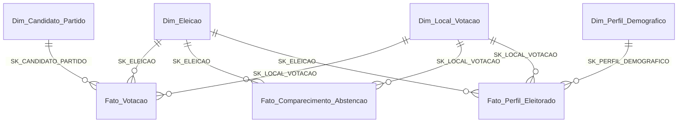

# 🗳️ Data Warehouse & Inteligência Eleitoral (TSE SP — 2018 & 2022)

Projeto de **Engenharia de Dados, Modelagem Dimensional (Kimball) e Business Intelligence** desenvolvido no **Innovation Lab — Applied BI & Relational Database Programming (T-SQL)** da **Faculdade Impacta** (3º Semestre de Ciência da Computação).

O sistema processa, higieniza e modela os microdados brutos oficiais do **Tribunal Superior Eleitoral (TSE)** do Estado de São Paulo (pleitos de **2018** e **2022**, totalizando **+20,4 milhões de registros** nas tabelas fato) para subsidiar decisões estratégicas de campanha para o cargo de **Deputado Estadual** (estudo de caso real: **Deputada Estadual Ana Carolina Serra — 23023 / Federação PSDB-Cidadania**).

---

## 🏗️ Arquitetura de Dados (Fact Constellation Schema)

Como os microdados do TSE possuem granularidades (grãos) incompatíveis entre votação por candidato, comparecimento por seção e perfil demográfico do eleitorado, foi projetado um **Fact Constellation Schema (3 Tabelas Fato compartilhando 4 Dimensões Conformadas)**. Essa decisão arquitetural elimina anomalias de multiplicação artificial de votos (*Fan Trap* / *Chasm Trap*) e garante integridade matemática estrita.

### 📊 Volumetria Auditada no SQL Server (`InnovationLab_AppliedBI`)

| Tabela | Tipo | Grão Declarado | Volume de Linhas |
| :--- | :---: | :--- | ---: |
| **`dbo.Fato_Votacao`** | Fato | `Candidato/Legenda × Seção Eleitoral × Eleição (2018 e 2022)` | **15.833.824** |
| **`dbo.Fato_Perfil_Eleitorado`** | Fato | `Perfil Sociodemográfico × Seção Eleitoral × Eleição (2022)` | **4.504.469** |
| **`dbo.Fato_Comparecimento_Abstencao`** | Fato | `Seção Eleitoral × Eleição (2022)` | **101.074** |
| **`dbo.Dim_Local_Votacao`** | Dimensão | `Colégio Eleitoral / Local de Votação em SP (645 municípios)` | **11.165** |
| **`dbo.Dim_Candidato_Partido`** | Dimensão | `Candidatos Nominais, Legendas (2 dígitos) e Códigos 95/96/-1` | **2.075** |
| **`dbo.Dim_Perfil_Demografico`** | Dimensão | `Combinação Faixa Etária × Escolaridade × Gênero` | **219** |
| **`dbo.Dim_Eleicao`** | Dimensão | `Pleitos Eleitorais (2018 e 2022)` | **5** |

---

## ⚙️ Engenharia de Dados & Pipeline ETL (Python + T-SQL)

### 1. Extração e Filtragem em Lotes com Python (`Pandas Chunking`)
Os arquivos brutos de votação por seção do TSE (`votacao_secao_2018_SP.csv` e `2022`) ultrapassam dezenas de milhões de linhas e causam estouro de memória RAM quando abertos de forma convencional.
- No script [`filtro.py`](./scripts/Innovation%20Lab%20Applied%20BI%20-%20Código%20para%20filtrar%20csv/filtro.py), implementamos leitura em streaming por blocos (`chunksize=100000`) com codificação `latin1`, filtrando exclusivamente os registros de Deputado Estadual (`CD_CARGO == 7`) com escrita incremental em disco.

### 2. Higienização Pesada em Staging Area (`T-SQL CTEs`)
Durante a ingestão para o SQL Server, tratamos problemas reais de qualidade de dados documentados em [`Problemas1310.md`](./Arquivos%20do%20projeto/Anotações/Problemas1310.md) e nos scripts em [`scripts/Scripts SQL/`](./scripts/Scripts%20SQL/):
- **Remoção de Qualificadores e Espaços**: Limpeza de aspas residuais (`REPLACE(COL, '"', '')`), `TRIM` e tratamento de strings `'#NULO'` com `NULLIF` e `COALESCE`.
- **Conversão Segura e Prevenção de Falha de Lote**: Uso de `TRY_CAST` para métricas numéricas e chaves naturais, impedindo que linhas malformadas abortassem a carga de milhões de registros.
- **Deduplicação Determinística**: Aplicação de `ROW_NUMBER() OVER (PARTITION BY CD_MUNICIPIO, NR_ZONA, NR_SECAO, NR_VOTAVEL ORDER BY ...)` em CTE para garantir unicidade antes da carga na `Fato_Votacao`.
- **Padronização de Collation e Encoding**: Resolução de conflitos `Latin1_General_CI_AI` e execução via `sqlcmd -f 65001` para preservar acentuação nos nomes dos 645 municípios e 11.164 colégios eleitorais.
- **Mapeamento Híbrido na `Fato_Votacao`**: Resolução em cascata (`COALESCE`) conectando votos nominais (`SQ_CANDIDATO`), votos de legenda partidária (`LEFT(NR_VOTAVEL, 2)`) e votos brancos/nulos (`95`, `96`, fallback `-1`).

---

## 📈 Camada Semântica: As 5 Views Analíticas e os 10 KPIs Eleitorais

No arquivo [`scripts/Scripts SQL/02_Views_10_KPIs.sql`](./scripts/Scripts%20SQL/02_Views_10_KPIs.sql) e no guia completo [`Guia_Definitivo_PowerBI_StarSchema_KPIs_e_Prompt.md`](./Guia_Definitivo_PowerBI_StarSchema_KPIs_e_Prompt.md), construímos a camada analítica OLAP (Views T-SQL + Medidas DAX auditadas):

1. **`dbo.vw_KPI_Painel_Local_Votacao`** *(Grão: 11.164 Locais de Votação)*
   - **KPI 1 (VHMS p.p.)**: Variação Histórica de Market Share Partidário (`PSDB 2018` vs `Federação PSDB/Cidadania 2022`).
   - **KPI 2 (TDL%)**: Taxa de Dominância por Local da candidata (`> 25%` Dominância / `>= 20%` Base Fiel).
   - **KPI 4 (RML%)**: Razão de Migração por Legenda Rival e saldo de votos nominais vs. legenda.
   - **KPI 5 (DELV & IVM)**: Densidade de Eleitores em Locais Vulneráveis.
   - **KPI 6 (TABF%)**: Taxa de Abstenção na Base Fiel.
   - **KPI 9 (ΔIAR p.p.)**: Variação de Votos Alienados (Brancos `95` + Nulos `96` sobre o total depositado na urna).
2. **`dbo.vw_KPI_Painel_Municipio_Mapa_SP`** *(Grão: 645 Municípios de SP)*
   - Consolidação municipal pronta para geolocalização no Power BI (`Azure Maps` / `Shape Map`), classificando municípios por status de crescimento ou retração eleitoral.
3. **`dbo.vw_KPI_Margem_Disputa_Zona`** *(Grão: Zona Eleitoral × Município)*
   - **KPI 3 (MDZ p.p.)**: Cálculo com `ROW_NUMBER()` identificando o 1º e o 2º colocado de cada Zona Eleitoral e classificando automaticamente **Swing Zones Prioritárias** (margem `<= 10 p.p.` do líder).
4. **`dbo.vw_KPI_Canibalizacao_Federacao_Municipio`** *(Grão: Candidato da Federação × Município)*
   - **KPI 7 (IDF%)** e **KPI 10 (ICF%)**: Índice de Dependência Partidária e Índice de Canibalização Regional intrafederação no Grande ABC e RMSP.
5. **`dbo.vw_KPI_Perfil_Demografico_Dominante`** *(Grão: Local de Votação)*
   - **KPI 8 (PDL)**: Segmentação em quartis (`NTILE(4)`) de desempenho eleitoral cruzada com a moda estatística (`ROW_NUMBER()`) de Faixa Etária, Escolaridade e Gênero para orientar comunicação segmentada em zonas de baixa penetração (1º Quartil).

---

## 📂 Estrutura Principal do Projeto

- [`Guia_Definitivo_PowerBI_StarSchema_KPIs_e_Prompt.md`](./Guia_Definitivo_PowerBI_StarSchema_KPIs_e_Prompt.md): Documentação mestre do Star Schema, auditoria matemática dos 10 KPIs, medidas DAX com `REMOVEFILTERS` e guia de construção do dashboard no Power BI.
- [`scripts/Scripts SQL/02_Views_10_KPIs.sql`](./scripts/Scripts%20SQL/02_Views_10_KPIs.sql): Script T-SQL completo das 5 Views analíticas dos 10 KPIs.
- [`scripts/Scripts SQL/`](./scripts/Scripts%20SQL/): Scripts de DDL, criação de dimensões, carga de fatos (`Fato_Votacao`, `Fato_Comparecimento_Abstencao`, `Fato_Perfil_Eleitorado`) e correções de integridade.
- [`scripts/Innovation Lab Applied BI - Código para filtrar csv/filtro.py`](./scripts/Innovation%20Lab%20Applied%20BI%20-%20Código%20para%20filtrar%20csv/filtro.py): Script Python de pré-processamento e filtragem de CSVs massivos em chunks.
- [`entregas_dimensionais/`](./entregas_dimensionais/) & [`Entregas/`](./Entregas/): Documentação executiva e pacotes de entrega das Sprints do projeto.

---

## 👥 Equipe — Start Phoenix Consultoria

Projeto desenvolvido no **Innovation Lab (Faculdade Impacta)**:
- **Paulo Vitor Gamileira Alves** — Engenharia de Dados, Pipeline ETL (Python/T-SQL), Modelagem Dimensional, Views Analíticas de KPIs e Camada Semântica DAX.
- **Caique Gonçalves Sambrana, Henrique Castilho Pires de Carvalho, João Vitor Costa Matos e Kauê Ribeiro Garcia Mendes**.
